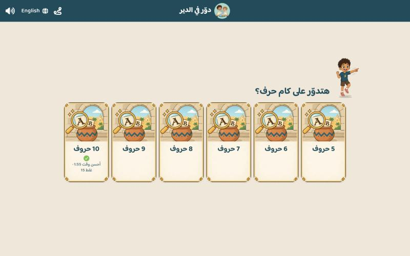
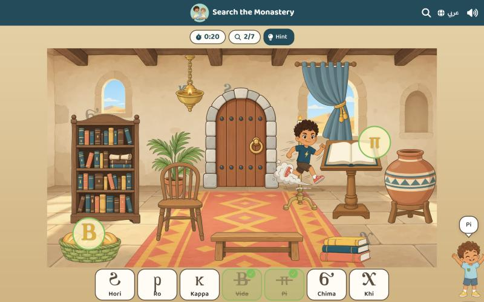
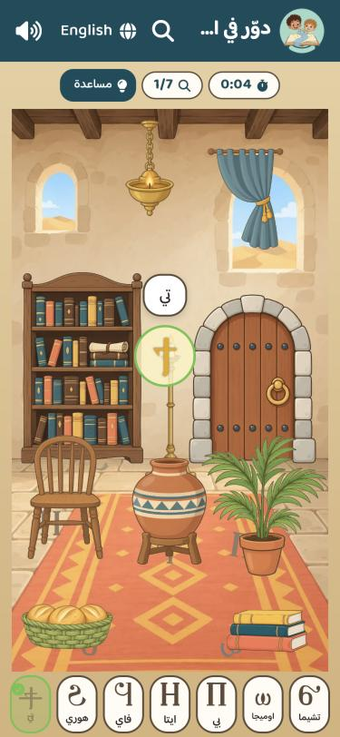
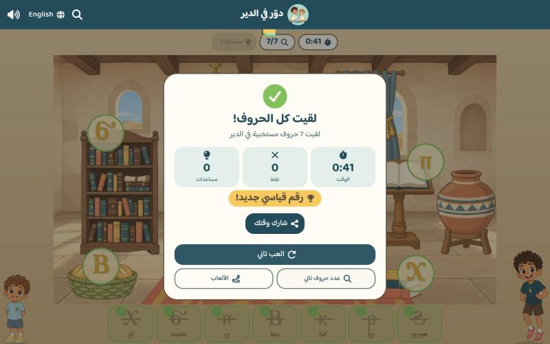

# Screenshots

Web build at 1280×800 (tablet landscape). Arabic unless the name ends in
`-english`.

## Home

The welcome screen: the story, the brothers' bios and the level picker.

## Levels

Pick one of the three levels.

## Player setup

Type your name and pick the brother you'll play with.

## Level road

A level's games on a winding road; your buddy runs to the game you tap.
Grandpa's Cards is the 4th stop and Search the Monastery the 5th, before
the challenge.

## Fish catch

Pick a letter, then catch the fish that carry it in the Nile.

## Catch the balloon

Pick a letter, then grab the balloons that carry it in the village.

## Write the letter

Colour the small and the capital letter with chalk on Grandpa's chalkboard.

## Grandpa's Cards: how many cards

Pick 4, 8, 16, 32 or 64 cards (phones stop at 32). A solved size shows a
green tick and its best time with that run's moves.

## Grandpa's Cards

Memory game by the sea in Alexandria: find each letter's capital and small
card. Your buddy runs to every card you tap, the other brother says the
letter's name; the timer, moves and pairs are on top.

## Grandpa's Cards: solved

Time, moves, the best time (or "New record!"), and sharing the result.

## Search the Monastery: how many letters

Pick 5 to 10 hidden letters, on phones too. Every tile is the same card;
a played level shows a green tick and its best time with that run's wrong
taps.

## Search the Monastery

Letters hide behind things in a monastery room, only part of each showing;
the ones to find are listed at the bottom with their names. Your buddy runs
to every letter you find and the other brother says its name (or "Not
here!" on a wrong tap); found letters turn gold and are crossed out. Timer,
letters found and a hint button on top.

Phones get a tall room of their own (no scrolling) and no brothers; the
name pops up in a bubble instead.

## Search the Monastery: all found

Time, wrong taps, hints, the best time (or "New record!"), and sharing the
result.

