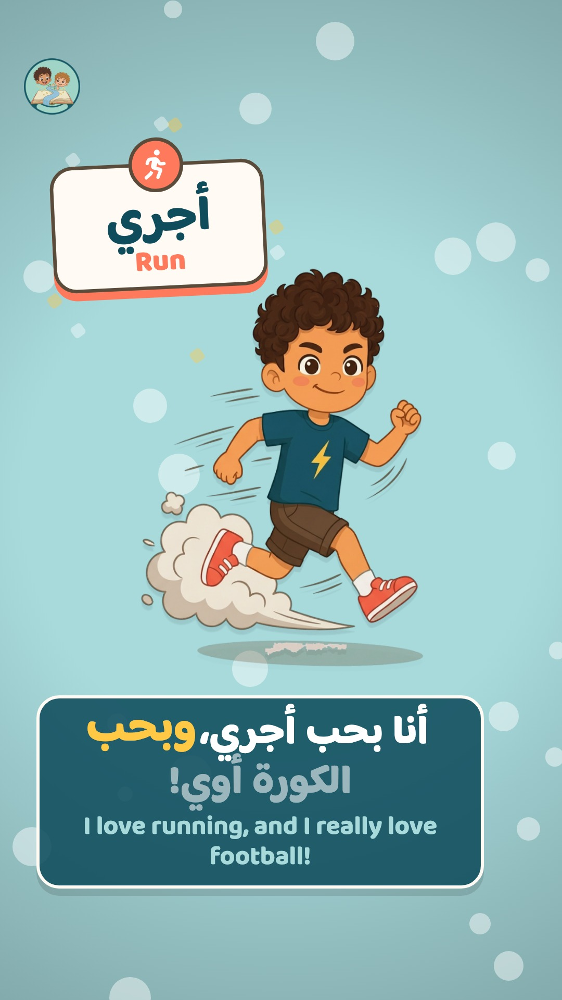
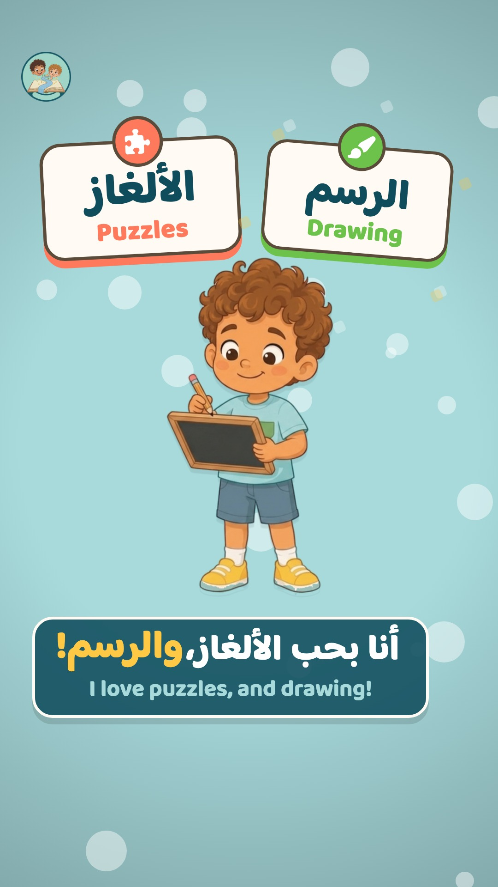

# Nono & Fofo · Social media (TikTok & Instagram)

Portrait motion-graphics videos (1080×1920, 30 fps) for kids 7–9: Egyptian
Arabic voices, Arabic + English captions, keyword pop-ups, scenes of 4–5 s max.
Motion is built in code with [Remotion](https://www.remotion.dev); voices come
from ElevenLabs (Eleven v3). The workflow lives in the `social-media` skill
(`.claude/skills/social-media/SKILL.md`).

## Folder map

| Path | What |
|---|---|
| `videos/<NNN-slug>/script.md` | The ElevenLabs script: line files, v3 text with emotion tags, captions |
| `videos/<NNN-slug>/video.json` | The scene list Remotion renders (format: `remotion/src/types.ts`) |
| `videos/<NNN-slug>/voice/` | The voice MP3s from ElevenLabs, named after each line id |
| `voices.md` | Nono's and Fofo's ElevenLabs voice prompts + v3 writing rules |
| `assets/` | **Social-only** resources (catalogued below and in `assets/manifest.json`) |
| `tools/split_voice.py` | Splits one ElevenLabs take into the per-line voice files |
| `tools/synth_social_sfx.py` | Synthesizes the social sound effects into `assets/sfx/` |
| `tools/synth_intro.py` | Composes the logo intro's score from `remotion/src/intro/cues.json` |
| `remotion/` | The Remotion project (components, timing, render scripts) |
| `previews/` | One still per video for the README and PRs |
| `out/` | Rendered MP4s and stills (git-ignored) |

## Where resources come from

- **From the app (never copied by hand, never edited here):** characters
  (`app/assets/characters`), colors (`AppColors` in `app_colors.dart`), fonts
  (Baloo Bhaijaan 2, Baloo 2, Avva Shenouda), music, SFX and the logo.
  `npm run sync` copies them into `remotion/public/` and reads the colors, so
  anything new added to the app is available to the videos automatically.
- **Social-only:** anything the videos need that the app doesn't goes in
  `assets/` and gets a row in the catalog below **and** an entry in
  `assets/manifest.json`.

## Commands

Run inside `social/remotion` (first time: `npm install`).

```bash
npm run studio                          # live preview / scrub in the browser
npm run still -- 001-nono-hello 2.5     # one frame -> out/001-nono-hello@2.5s.jpg
npm run render -- 001-nono-hello        # full video -> out/001-nono-hello.mp4
npm run intro                           # logo intro -> out/intro-landscape.mp4 + out/intro-portrait.mp4
npm run still -- intro-portrait 12.5    # one intro frame
tools/.venv/bin/python social/tools/synth_intro.py        # (from repo root) rebuild the intro score
tools/.venv/bin/python social/tools/synth_social_sfx.py   # (from repo root) rebuild social SFX
```

## Asset catalog (social-only)

### Sound effects (`assets/sfx/`, made by `tools/synth_social_sfx.py`)

| id | Sound | Used for |
|---|---|---|
| `mg_whoosh_in` | Airy whoosh up | Character flies in (automatic) |
| `mg_whoosh_out` | Whoosh down | Something flies out |
| `mg_scene_swipe` | Swish + tick | Scene wipe (automatic) |
| `mg_keyword_pop` | Pop + ding | Keyword card (automatic, 1st/3rd…) |
| `mg_keyword_pop_2` | Pop + chime | Keyword card (automatic, 2nd/4th…) |
| `mg_word_tick` | Tiny tick | Caption word highlight (optional) |
| `mg_boing` | Cartoon boing | Bounce / "pop" entrance (automatic) |
| `mg_pose_swap` | Quick "fwip" | Pose change (automatic) |
| `mg_slide_up` / `mg_slide_down` | Slide whistle | Rising / dropping things |
| `mg_logo_sting` | Darbuka + qanun run + sparkles | End card (automatic) |
| `mg_sparkle` | Magic shimmer | Stars, shining letters |
| `mg_ta_da` | Marimba + bell reveal | Big moment / catchphrase |

### Music (`assets/music/`)

| id | Track | Used for |
|---|---|---|
| `intro_logo_swarm` | 24 s score, 120 BPM, D hijaz: granular swarm shimmer, darbuka maqsum, bass, qanun, a sound for each shape, auto-panned ring spin, final drop. Made by `tools/synth_intro.py`, cued from `remotion/src/intro/cues.json` | Logo intro |

All 107 app SFX (`correct_1`, `confetti`, `fish_splash_1`, …) can be used by id
too; see `app/assets/audio/manifest.json`.

### Images (`assets/images/`)

None yet.

### Icons (keyword cards)

Font Awesome, registered in `remotion/src/icons.ts`: `book`, `clap`, `fish`,
`football`, `heart`, `house`, `idea`, `paint`, `puzzle`, `question`, `rocket`,
`run`, `star`, `trophy`.

## Logo intro ("Golden Letter Swarm")

A 24 s particle intro built from the app logo, in two shapes: `intro-portrait`
(1080×1920) and `intro-landscape` (1920×1080), 60 fps. Code in
`remotion/src/intro/`. Picture and sound share one clock, `cues.json`: change a
time there, rerun `synth_intro.py`, and re-render.

7,000 gold particles drawn on a canvas each frame. Their positions are a pure
function of time, so any frame renders the same. Every shape is sampled from
pixels (`shapes.ts`): text in the Coptic font, drawn shapes, the brothers' wave
poses and the logo itself.

1. **ⲁ ⲱ (0–2.5 s):** gold dust gathers into alpha and omega, then shatters.
2. **The flock (2.5–16 s):** on every bar the swarm flies to a new shape: pyramid
   and sun → swaying palm → flowing Nile → open book → Nono and Fofo waving
   (in their real colours) → ⲛⲟⲛⲟ / ⲫⲟⲫⲟ → a spinning 3D ring.
3. **Spiral in (16–20 s):** the ring spins faster and tilts flat, then every
   particle spirals to its pixel of the logo (centre first) and the real logo
   resolves on the drop.
4. **Hold (20–24 s):** a shine sweep, then the logo stays perfectly still.

## Videos

| Folder | Title | Status |
|---|---|---|
| `001-nono-hello` | Nono says hi (demo) | Voiced (one take split into 4 lines) · rendered |
| `002-fofo-hello` | Fofo says hi (demo) | Voiced (one take split by hand with `--lines`) · rendered |

<p>
  
  
</p>
